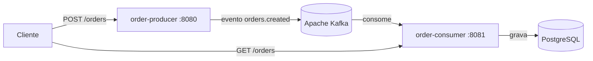

# Kafka Order Events

Projeto de estudo de **mensageria com Apache Kafka** usando Java e Spring Boot.
Dois microsserviços independentes se comunicam por eventos: um recebe pedidos via REST
e publica no Kafka, o outro consome os eventos e grava os pedidos no PostgreSQL.

## Arquitetura



- **order-producer:** valida o pedido, calcula o total e publica o evento `orders.created`.
- **order-consumer:** escuta o tópico, grava o pedido no banco e expõe `GET /orders` para consulta.
- **Kafka (modo KRaft, sem Zookeeper)** e **PostgreSQL** rodam via Docker Compose.
- **Kafka UI** para visualizar tópicos, partições e mensagens.

## Tecnologias

Java 17, Spring Boot 3.3, Spring Kafka, Spring Data JPA / Hibernate, PostgreSQL, Apache Kafka,
Docker e Docker Compose, Maven, JUnit 5, Mockito, Swagger/OpenAPI e GitHub Actions.

## Como rodar

Pré-requisito: Docker com Docker Compose.

```bash
docker compose up --build
```

Na primeira vez o build leva alguns minutos. Quando tudo subir:

| Serviço | URL |
|---|---|
| Producer (Swagger) | http://localhost:8080/swagger-ui.html |
| Consumer (Swagger) | http://localhost:8081/swagger-ui.html |
| Kafka UI | http://localhost:8085 |

### Testando o fluxo

1. Crie um pedido:

```bash
curl -X POST http://localhost:8080/orders \
  -H "Content-Type: application/json" \
  -d '{"customer":"Maria","product":"Teclado","quantity":2,"unitPrice":150.00}'
```

2. Consulte o que o consumidor processou:

```bash
curl http://localhost:8081/orders
```

3. Abra o Kafka UI e veja o tópico `orders.created` com a mensagem.

Para parar e limpar tudo: `docker compose down -v`.

## Testes

```bash
cd order-producer && mvn test
cd order-consumer && mvn test
```

Os testes unitários (JUnit 5 + Mockito) cobrem:

- cálculo do total e publicação do evento;
- uso do `orderId` como chave da mensagem;
- gravação de um pedido novo;
- descarte de evento duplicado (idempotência).

O GitHub Actions roda os testes dos dois módulos a cada push e pull request.

## Decisões de design

- **Chave da mensagem = `orderId`:** eventos do mesmo pedido vão sempre para a mesma partição, mantendo a ordem.
- **Tópico com 3 partições:** permite escalar o consumidor com mais instâncias no mesmo `group-id`.
- **`acks=all` e producer idempotente:** reduz o risco de perder ou duplicar mensagens ao publicar.
- **Consumidor idempotente:** o Kafka entrega "pelo menos uma vez", então um evento duplicado não gera pedido duplicado.
- **`ErrorHandlingDeserializer`:** uma mensagem malformada não trava o consumidor.
- **Retry com backoff:** 3 novas tentativas, 1 segundo entre elas, em caso de falha no processamento.
- **Contrato por JSON, sem biblioteca compartilhada:** cada serviço tem sua própria classe do evento, mantendo o desacoplamento.
- **Docker multi-stage:** a imagem final tem só o JRE e o jar.

## Próximos passos

- Dead Letter Topic para mensagens que falham após todas as tentativas.
- Testes de integração com Testcontainers (Kafka e PostgreSQL reais).
- Migrations com Flyway no lugar de `ddl-auto: update`.
- Manifestos Kubernetes para rodar os serviços em um cluster local (kind ou minikube).
- Schema Registry com Avro para versionar o contrato dos eventos.
